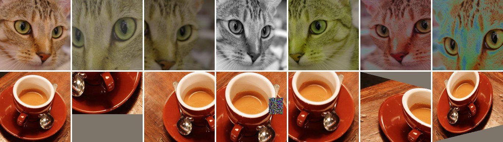
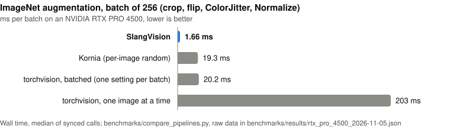

<h1 align="center">SlangVision</h1>

<p align="center">
  <b>GPU training augmentation for PyTorch.</b><br>
  torchvision's transforms and results, a separate random draw for every image,<br>
  fused into a few CUDA kernels written in plain <a href="https://shader-slang.org/">Slang</a>.
</p>

<p align="center">
  <a href="https://pypi.org/project/slangvision/"></a>
  <a href="https://pypi.org/project/slangvision/"></a>
  <a href="https://github.com/tekintatar/slangvision/actions/workflows/checks.yml"></a>
  <a href="https://github.com/tekintatar/slangvision/blob/main/LICENSE"></a>
</p>

<p align="center">
  
</p>
<p align="center"><sub>
  Left: the photo. Right: six images from one batch, each with its own random values.
  Top: the SimCLR recipe. Bottom: timm's RandAugment with random erasing, as DeiT trains.
  Photos: scikit-image sample data (CC0).
</sub></p>

<p align="center">
  <a href="#install">Install</a> ·
  <a href="#quick-start">Quick start</a> ·
  <a href="#transforms">Transforms</a> ·
  <a href="#recipes">Recipes</a> ·
  <a href="#performance">Performance</a> ·
  <a href="#how-it-works">How it works</a> ·
  <a href="#documentation">Documentation</a> ·
  <a href="#limits">Limits</a>
</p>

## Highlights

- **Fast.** An ImageNet augmentation batch of 256 takes 1.7 ms on an RTX PRO
  4500, against 20 ms for torchvision's batched transforms (one setting for
  the whole batch), 19 ms for Kornia, and 203 ms for torchvision one image at
  a time.
- **torchvision's results.** Each transform matches torchvision's float
  functional image by image (about 1e-5 in float32). Pipelines that run
  torchvision on uint8 or PIL images differ by its rounding, up to 1/255 per
  op ([Accuracy](https://github.com/tekintatar/slangvision/blob/main/docs/GUIDE.md#accuracy)).
- **Per-image randomness.** Every image gets its own crop, flip, jitter
  factors and op choices; `same_on_batch=True` on a transform shares them.
  Seeded from `torch.manual_seed`, with no host sync.
- **Reads any decoder's output in place**: a uint8 batch, or a list of
  differently sized images from `torchvision.io`, nvImageCodec, DALI or
  DataLoader workers (`layout="hwc"` for `(H, W, 3)`). Decode on the GPU too
  for the full speed-up: with CPU decoding in DataLoader workers it pays off
  only for ImageNet-sized photos, since the workers then ship whole images.
- **Your own ops in a few lines.** A custom augmentation is a Python class
  with one Slang function, fused into the same kernels as the built-ins.
- **Light.** Pure Python plus Slang source: no compiled extension to build.

> **Pre-alpha**: APIs may still change. This page describes `main`, which has
> transforms not yet released on PyPI (see the
> [changelog](https://github.com/tekintatar/slangvision/blob/main/CHANGELOG.md)).

## Install

Linux with an NVIDIA GPU, Python 3.10–3.13 and PyTorch with CUDA:

```bash
pip install slangvision torchvision   # torchvision: for checking results against it
python -m slangvision setup           # once per environment
```

For the unreleased transforms on `main`:
`pip install git+https://github.com/tekintatar/slangvision`.

No CUDA Toolkit or environment variables are needed: SlangVision compiles
its kernels with the NVRTC that pip installs with PyTorch, and `setup` adds
the one link SlangPy needs to find it. `setup` checks that this NVRTC is not
newer than your driver supports. If it is (PyTorch 2.15's NVRTC 13.2 with
driver 580, for example), update the driver or pin an older NVRTC, **after**
your other installs, since any later install of torch or torchvision puts
PyTorch's NVRTC back:

```bash
pip install "cuda-toolkit[nvrtc,cudart]==13.0.*"   # your driver's CUDA version (nvidia-smi)
```

pip prints an ERROR about a conflict with torch's pin and installs it anyway;
PyTorch keeps working. Your own
CUDA Toolkit works too: see
[Requirements](https://github.com/tekintatar/slangvision/blob/main/docs/GUIDE.md#requirements).

## Quick start

```python
import torch
import slangvision as A

train = A.Compose([
    A.RandomResizedCrop(224),
    A.RandomHorizontalFlip(),
    A.ColorJitter(0.4, 0.4, 0.4, 0.1),
    A.Normalize(mean=(0.485, 0.456, 0.406), std=(0.229, 0.224, 0.225)),
])
images = torch.randint(0, 256, (64, 3, 480, 640), dtype=torch.uint8, device="cuda")
x = train(images)   # (64, 3, 224, 224) float16, on the current CUDA stream
```

- Input: a `(B, 3, H, W)` uint8 CUDA tensor, or a list of decoded images of
  any sizes.
- Output: `Compose(..., dtype=torch.float16)` by default; `torch.bfloat16`
  and `torch.float32` too.
- Import `slangvision` before anything decodes on the GPU (torchvision's
  `decode_jpeg(..., device="cuda")`, DALI): in the other order SlangPy
  cannot start, and SlangVision stops with an error that says so.
- The first call compiles the pipeline (about 2 s); later calls reuse the
  kernels, and compiled kernels are cached on disk, so the first call in a
  later process takes about 1.5 s.

## Transforms

torchvision's names and parameters, with random values drawn per image:

| Kind | Transforms |
|---|---|
| Geometry | `RandomResizedCrop`, `Resize` (bilinear or bicubic), `CenterCrop`, `RandomCrop`, `Pad`, `RandomHorizontalFlip`, `RandomVerticalFlip` |
| Warps | `RandomRotation`, `RandomAffine`, `RandomPerspective` |
| Colour | `ColorJitter`, `RandomPhotometricDistort`, `RandomChannelPermutation`, `Grayscale`, `RandomGrayscale`, `RandomSolarize`, `RandomInvert`, `RandomPosterize`, `RandomAutocontrast`, `RandomEqualize`, `GaussianNoise` |
| Filters | `GaussianBlur`, `RandomAdjustSharpness` |
| Policies | `RandAugment`, `TrivialAugmentWide`, `AutoAugment`, and `TimmRandAugment` (timm's RandAugment with Pillow's ops, as DeiT, ConvNeXt and Swin train) |
| Composition and output | `RandomApply`, `RandomChoice`, `Normalize`, `RandomErasing` |
| Batch mixing | `MixUp`, `CutMix` (torchvision's, draw for draw), `TimmMixup` (timm's `Mixup`) |
| Super resolution | `slangvision.sr`: BasicSR's `USMSharp`, `DiffJPEG` and noise functions, as drop-in replacements |
| Your own | `ColorOp` (per-pixel), `NeighborhoodOp` (reads neighbouring pixels) |

Pipelines are checked when you build them: geometry comes first and fixes
the output size, and `Normalize` comes last. Coming from Albumentations? The
guide maps its popular transforms to these
([Coming from Albumentations](https://github.com/tekintatar/slangvision/blob/main/docs/GUIDE.md#coming-from-albumentations)).

## Recipes

<details>
<summary><b>SimCLR</b> (self-supervised)</summary>

```python
import slangvision as A

simclr = A.Compose([
    A.RandomResizedCrop(224),
    A.RandomHorizontalFlip(),
    A.RandomApply([A.ColorJitter(0.4, 0.4, 0.2, 0.1)], p=0.8),
    A.RandomGrayscale(p=0.2),
    A.RandomApply([A.GaussianBlur(23)], p=0.5),
    A.RandomSolarize(0.5, p=0.2),
    A.Normalize(mean=(0.485, 0.456, 0.406), std=(0.229, 0.224, 0.225)),
])
```
</details>

<details>
<summary><b>DeiT and ConvNeXt</b> (timm's RandAugment, random erasing, MixUp and CutMix)</summary>

```python
import slangvision as A

mean, std = (0.485, 0.456, 0.406), (0.229, 0.224, 0.225)
train = A.Compose([
    A.RandomResizedCrop(224, interpolation="bicubic"),
    A.RandomHorizontalFlip(),
    A.TimmRandAugment("rand-m9-mstd0.5-inc1", interpolation="bicubic"),
    A.Normalize(mean, std),
    A.RandomErasing(p=0.25, scale=(0.02, 1 / 3), ratio=(0.3, 1 / 0.3), value="random"),
])
mix = A.TimmMixup(mixup_alpha=0.8, cutmix_alpha=1.0, label_smoothing=0.1, num_classes=1000)
x, y = mix(train(images), labels)      # labels: (B,) class indices
```

`MixUp` and `CutMix` are torchvision's, draw for draw: the same seed gives
torchvision's result. `TimmMixup` is timm's `Mixup`, with per-batch,
per-pair or per-image mixing.
</details>

<details>
<summary><b>Your own op</b> (one Slang function)</summary>

```python
import slangvision as A

class RandomGamma(A.ColorOp):
    """Gamma correction with a random exponent per image."""
    params = {"gamma": A.Uniform(0.8, 1.25)}
    slang = "float4 apply(float4 c, float gamma) { return clamp01(pow(c, float4(gamma))); }"

    def reference(self, img, gamma):          # optional: torch, one (3, H, W) image
        return img.clamp(0, 1) ** gamma

train = A.Compose([A.RandomResizedCrop(224), A.RandomHorizontalFlip(), RandomGamma(p=0.5)])
```

`apply` gets the pixel and one value per parameter, drawn per image. Ops that
read neighbouring pixels (blurs, filters) subclass `A.NeighborhoodOp` the
same way. `slangvision.testing.max_reference_error(train, images)` checks a
pipeline against torchvision and your references, and `train.source` shows
the generated Slang.
</details>

<details>
<summary><b>Super resolution</b> (Real-ESRGAN's degradation)</summary>

```python
# was: from basicsr.utils.img_process_util import USMSharp
#      from basicsr.data.degradations import random_add_gaussian_noise_pt, random_add_poisson_noise_pt
#      from basicsr.utils import DiffJPEG
from slangvision.sr import (DiffJPEG, USMSharp, random_add_gaussian_noise_pt,
                            random_add_poisson_noise_pt)
```

Drop-in replacements for the BasicSR functions that Real-ESRGAN's training
step calls on the GPU, with the same arguments and results: USM sharpening of
the targets takes 1.5 ms instead of 118 ms per batch of 12 at 400×400 (RTX
PRO 4500), and making Real-ESRGAN's whole low-resolution batch drops from
127 ms to under 8 ms. Details, and where BasicSR's DiffJPEG differs from a
real JPEG encoder, are in
[SR.md](https://github.com/tekintatar/slangvision/blob/main/docs/SR.md).
</details>

More in the guide: CIFAR and DeiT III's ThreeAugment
([Recipes](https://github.com/tekintatar/slangvision/blob/main/docs/GUIDE.md#recipes)),
and decoding with torchvision, nvImageCodec, DALI or DataLoader workers
([Inputs and decoders](https://github.com/tekintatar/slangvision/blob/main/docs/GUIDE.md#inputs-and-decoders)).

## Performance

<p align="center">
  
</p>

Batch 256, 512×384 uint8 in, 224×224 fp16 out, one NVIDIA RTX PRO 4500
Blackwell, ms per batch, wall time (GPU time):

| Recipe | SlangVision | torchvision, batched | torchvision, one image at a time | Kornia (per-image random) |
|---|---:|---:|---:|---:|
| ImageNet: crop, flip, ColorJitter, Normalize | **1.66** (1.47) | 20.2 (20.2) | 203 (35.7) | 19.3 (14.0) |
| Evaluation: Resize, CenterCrop | **0.87** (0.66) | 5.60 (5.80) | 27.6 (7.65) | — |
| SimCLR: + grayscale, blur, solarize | **2.54** (2.30) | 20.5 (26.5) | 221 (40.4) | 29.7 (23.8) |

torchvision's batched mode does less work (one random setting for all 256
images); its per-image loop is the like-for-like comparison, and most of its
wall time is launching small kernels (about 86 per image).
`benchmarks/compare_pipelines.py` reproduces this table; raw data in
[`benchmarks/results/rtx_pro_4500_2026-11-05.json`](https://github.com/tekintatar/slangvision/blob/main/benchmarks/results/rtx_pro_4500_2026-11-05.json)
(an earlier H100 run is in the script's header).

<details>
<summary><b>In training</b>: images per second with CPU and GPU decoding (H100, indicative)</summary>

In real training, decoding usually decides throughput. Training from scratch
on an ImageNet subset (45,000 JPEGs, batch 256, bf16) on one H100 NVL with 18
CPU cores, images per second:

| Input pipeline | ResNet-18 | ResNet-50 |
|---|---:|---:|
| DataLoader (16 workers): decode + torchvision augmentation | 2,721 | 2,671 |
| DataLoader decode + SlangVision | 3,781 | 3,254 |
| DALI decode + DALI augmentation | 8,655 | 3,518 |
| DALI decode + SlangVision | 8,393 | 3,395 |

Moving augmentation to the GPU gives 1.4× (ResNet-18) with CPU decoding of
ImageNet-sized photos; with larger ones decode on the GPU too (the guide
has an FGVC-Aircraft benchmark at about 0.7 MP). With DALI's GPU decoding,
training runs within about 3% of DALI's own augmentation, with torchvision's
results instead of DALI's approximations. This table is indicative: it was
measured with an earlier version of the kernels (shipped as
`slangimage.augment`), one run per row, with a training script that is not
in this repository.
</details>

Method and caveats are in the guide's
[Performance](https://github.com/tekintatar/slangvision/blob/main/docs/GUIDE.md#performance)
section.

## How it works

`Compose` turns the pipeline into a few GPU kernels when you build it:

1. A **sampler** kernel draws every image's random values into a small
   table, so there is no Python loop over the images and no host sync.
2. A **pass** computes each output pixel once: the first pass crops and
   resizes from your images and applies the flips and colour ops after it.
   Each blur, warp or policy op starts a new pass.
3. Ops that need a statistic of each image (ColorJitter's contrast,
   autocontrast, equalize) get a **pre-pass** that measures it first.

The kernels are plain Slang compiled by NVRTC through
[SlangPy](https://github.com/shader-slang/slangpy) and run on PyTorch's
current CUDA stream.
[How a pipeline runs](https://github.com/tekintatar/slangvision/blob/main/docs/GUIDE.md#how-a-pipeline-runs)
has the details.

## Documentation

| Page | What it covers |
|---|---|
| [Guide](https://github.com/tekintatar/slangvision/blob/main/docs/GUIDE.md) | Pipeline rules, every transform's arguments, policies, recipes, decoders, custom ops, accuracy, performance |
| [Super resolution](https://github.com/tekintatar/slangvision/blob/main/docs/SR.md) | `slangvision.sr`: BasicSR's degradations, measurements, the DiffJPEG analysis |
| [Test evidence](https://github.com/tekintatar/slangvision/blob/main/docs/TESTING.md) | How each transform is checked against torchvision, and validation records |
| [Roadmap](https://github.com/tekintatar/slangvision/blob/main/docs/ROADMAP.md) | What may come next |
| [Changelog](https://github.com/tekintatar/slangvision/blob/main/CHANGELOG.md) | What changed, release by release |
| [Contributing](https://github.com/tekintatar/slangvision/blob/main/CONTRIBUTING.md) | Setup, tests, adding a transform |

## Limits

- CUDA only (Linux with an NVIDIA GPU), and not inside CUDA graph capture.
- Run pipelines from one thread (SlangPy devices are thread-affine).
- Call pipelines outside `torch.compile`d code (they run their own kernels).
- Not yet: AugMix, masks and boxes.

## Related

[SlangImage](https://github.com/tekintatar/slangimage) is the image-processing
sibling: 44 photo-editing operators (bilateral, CLAHE, NL-means, colour,
geometry, stylization) on Metal, CUDA and Vulkan, built the same way.

## Citing

If you use SlangVision in research, GitHub's "Cite this repository" button
gives a citation from
[CITATION.cff](https://github.com/tekintatar/slangvision/blob/main/CITATION.cff).

## License

Copyright 2026 Tekin Tatar. Licensed under
[Apache-2.0](https://github.com/tekintatar/slangvision/blob/main/LICENSE) (see
[NOTICE](https://github.com/tekintatar/slangvision/blob/main/NOTICE)).
SlangVision is built on Slang and SlangPy but is not affiliated with the
Slang project or Khronos.
